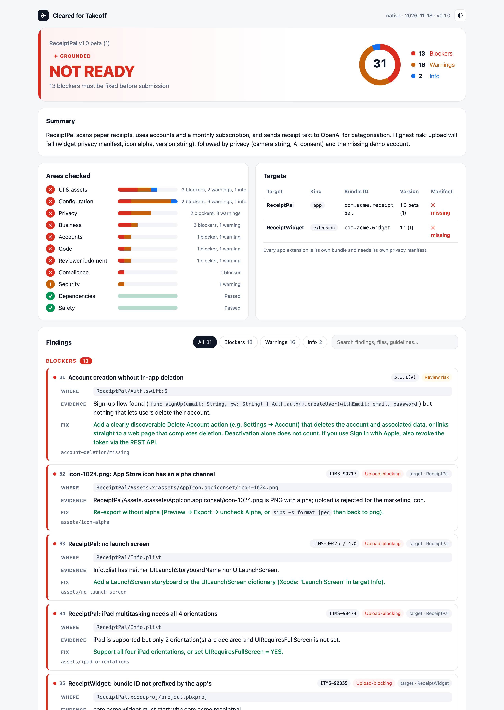

# ✈︎ cleared-for-takeoff

**Run the preflight before App Review does.** Catch App Store rejections before Apple does. Your app is either **grounded**, **holding short**, or **cleared for takeoff**. An agent skill (Claude Code, and any Agent Skills–compatible tool) plus a zero-dependency scanner for **iOS apps built with Swift/ObjC, React Native, Expo or Flutter**.

<p align="center">
  <picture>
    <source media="(prefers-color-scheme: dark)" srcset="assets/report-dark.png">
    
  </picture>
  <br><sub>The HTML report (<a href="assets/demo-report.html">demo source</a>): verdict, areas, per-target manifests, and findings you can filter and search, each with evidence and a fix.</sub>
</p>

```
$ python3 skills/cleared-for-takeoff/scripts/preflight.py ~/code/MyApp --html report.html
Readiness: NOT READY - 2 blocker(s) must be fixed before submission
  [B1] StatsWidget: no PrivacyInfo.xcprivacy              [ITMS-91053]
       at StatsWidget/Info.plist
  [B2] Missing NSCameraUsageDescription required by image_picker   [5.1.1(ii) / ITMS-90683]
  [W1] Personal data may be sent to a third-party AI without explicit consent   [5.1.2(i)]
       at lib/voice/transcribe.dart:30
  …
HTML report: /Users/you/code/MyApp/report.html
```

## Why another one?

The existing App Review skills are all prompt-only. The model greps by hand, so results vary from run to run and false positives are common. This project combines the best ideas of four of them with a **real scanner**:

| | Scanner | file:line | Per-target (extensions) | Live guidelines | Confidence levels | RN/Expo | Flutter | Built .ipa/.xcarchive | CI exit code |
|---|---|---|---|---|---|---|---|---|---|
| safaiyeh/app-store-review-skill | – | – | – | – | – | ✅ | – | – | – |
| dabodamjan/app-store-rejection-checker | – | partial | – | ✅ | ✅ | – | – | – | – |
| truongduy2611/cleared-for-takeoff-skills | – | partial | – | – | – | – | partial | – | – |
| JustinPerea/app-store-review-skill | – | ✅ | ✅ | – | – | – | – | – | – |
| **cleared-for-takeoff** | ✅ | ✅ | ✅ | ✅ | ✅ | ✅ | ✅ | ✅ | ✅ |

The two layers split the work:

1. **Scanner** (Python 3.9+, stdlib only, under 1s). It parses `project.pbxproj` (including Xcode 16 synchronized folders and xcconfig layering), every target's Info.plist, entitlements and privacy manifests, Expo `app.json`, Flutter plugins, Pods, SwiftPM and npm. It runs 18 checks and emits JSON or text.
2. **Skill** (the agent layer). It verifies each lead by reading the code, classifies the app, loads the matching checklists, reads the **live** App Review Guidelines and Apple news, does the judgment review (2.1, 2.3, 2.5.19, 4.2/4.3, 5.1.2(i) AI, 1.2 UGC, 3.1), checks your App Store Connect metadata (via the `asc` CLI, fastlane, or a paste), and writes a report. The report has a verdict, fixes, a "Not checked" section, an external checklist, and a draft App Review notes block.

## What it checks

| Check | Catches |
|---|---|
| `privacy-strings` | APIs and SDK plugins (expo-camera, image_picker…) without purpose strings; vague or default strings |
| `privacy-manifest` | Missing or incomplete `PrivacyInfo.xcprivacy` **per target**: the widget/extension ITMS-91053 trap |
| `dependencies` | Apple-listed SDKs without manifests (ITMS-91061); GPL dependencies |
| `entitlements` | SIWA/push/HealthKit capability mismatches; unjustified background modes |
| `assets` | 1024 icon missing, wrong size or with alpha; no launch screen; iPad orientation rules |
| `build-config` | Invalid versions; extension ID and version mismatches; Apple trademarks in the name; Debug archive scheme |
| `networking` | ATS disabled; IPv4 literals (review runs on IPv6); cleartext URLs |
| `login-services` | Google/Facebook login without Sign in with Apple (4.8) |
| `account-deletion` | Sign-up without in-app deletion (5.1.1(v)) |
| `payments` | No restore; subscription screen without Terms/Privacy; hardcoded prices; external payment SDKs; loot boxes |
| `att` | Ad/attribution SDKs without ATT; ATT key without a prompt; prompt called too early |
| `ai-consent` | OpenAI/Gemini/Anthropic/… calls without a consent gate (5.1.2(i)) |
| `ugc` | Chat/feeds/AI content without report, block or terms (1.2) |
| `hidden-features` | Reviewer detection, sandbox gating, undocumented remote flags (2.5.19) |
| `code` | UIWebView, private selectors, `eval`, `exit(0)`, custom rating prompts, OTA limits |
| `secrets` | Stripe/AWS/OpenAI/Anthropic/GitHub keys in the bundle (shippable client keys are allowed) |
| `content` | "Coming soon", lorem ipsum, Android/Google Play mentions, beta copy |
| `export-compliance` | Missing `ITSAppUsesNonExemptEncryption` |

Debug-only code (`#if DEBUG`, `__DEV__`, `kDebugMode`), comments, and test or preview folders are ignored.

## Install

**Claude Code plugin**
```
/plugin marketplace add Paul-Sizon/cleared-for-takeoff
/plugin install cleared-for-takeoff@cleared-for-takeoff
```

**skills CLI** (Claude Code, Codex, Cursor, …)
```
npx skills add Paul-Sizon/cleared-for-takeoff
```

**Manual**
```
git clone https://github.com/Paul-Sizon/cleared-for-takeoff
ln -s "$PWD/cleared-for-takeoff/skills/cleared-for-takeoff" ~/.claude/skills/cleared-for-takeoff
```

## Use

In your agent: *"preflight my app for the App Store"*, *"will this get rejected?"*, or *"Apple rejected me for 4.8, help"*.

Scanner only:
```bash
S=skills/cleared-for-takeoff/scripts/preflight.py
python3 $S /path/to/app                    # human-readable
python3 $S /path/to/app --json             # machine-readable
python3 $S /path/to/app --html report.html # self-contained HTML report (light/dark, filters, search)
python3 $S --from-json enriched.json --html report.html   # re-render JSON the agent edited
python3 $S build/App.xcarchive             # built product → validator-certain findings
python3 $S /path/to/app --ci --strict      # exit 1 on blockers (or warnings) for CI
python3 $S --list-checks
```

**CI (GitHub Actions)**
```yaml
- run: git clone --depth 1 https://github.com/Paul-Sizon/cleared-for-takeoff /tmp/asp
- run: python3 /tmp/asp/skills/cleared-for-takeoff/scripts/preflight.py . --ci --html preflight-report.html
- uses: actions/upload-artifact@v4
  if: always()
  with: { name: preflight-report, path: preflight-report.html }
```

**Suppress a false positive:** add `rule-id [path-glob]` to `.preflightignore` in the app root, or put `// preflight:ignore rule-id` on or above the line.

## HTML report

`--html report.html` writes one self-contained file with no external assets, so you can attach it to a PR, a CI artifact or Slack. It contains:
- **Verdict hero** with a severity donut
- **Areas checked**: a status icon and a stacked severity bar per area, so you see at a glance where the problems cluster
- **Targets**: app and extension bundles, versions, and whether each has its own privacy manifest
- **Findings**: severity filters and search; each card shows the guideline/ITMS code, confidence, `file:line`, evidence and fix
- When the skill runs: a **Summary**, **reviewer-judgment findings** (metadata accuracy, 2.1 demo access, 4.3…), **Draft App Review notes** with a copy button, and a **Before you press Submit** checklist
- Light/dark (follows the system; toggle in the header). Prints cleanly.

The skill scans to JSON, verifies and enriches it (drops false positives, adds judgment findings, `summary_text`, `review_notes`, `external_checklist`, `verification_note`), then renders with `--from-json`. Regenerate the README demo with `python3 evals/make_demo.py`.

## Confidence model

Every finding is one of:
- **validator-certain**: Apple's upload validation blocks it, and the evidence comes from a built product.
- **review-risk (validator-blocking…)**: the same gate, but seen in source only, so it needs build verification.
- **review-risk**: a commonly rejected pattern with evidence.
- **judgment-call**: a reasonable reviewer could go either way.

No finding ever says "you will be approved". The tool reduces known risks and nothing more.

## Develop

```bash
python3 -m unittest discover tests        # builds fixture apps in a temp dir, runs all checks
python3 evals/fixtures/build_fixtures.py /tmp/fx   # inspect the fixture projects
```
Adding a check: create a module in `scripts/preflight/checks/` with `@check(...)`, add a fixture case and a test, and write `references/rules/<check-id>.md`.

Guidelines last verified against developer.apple.com: **2026-11-18** (see `references/recent-changes.md`).

MIT licensed.
